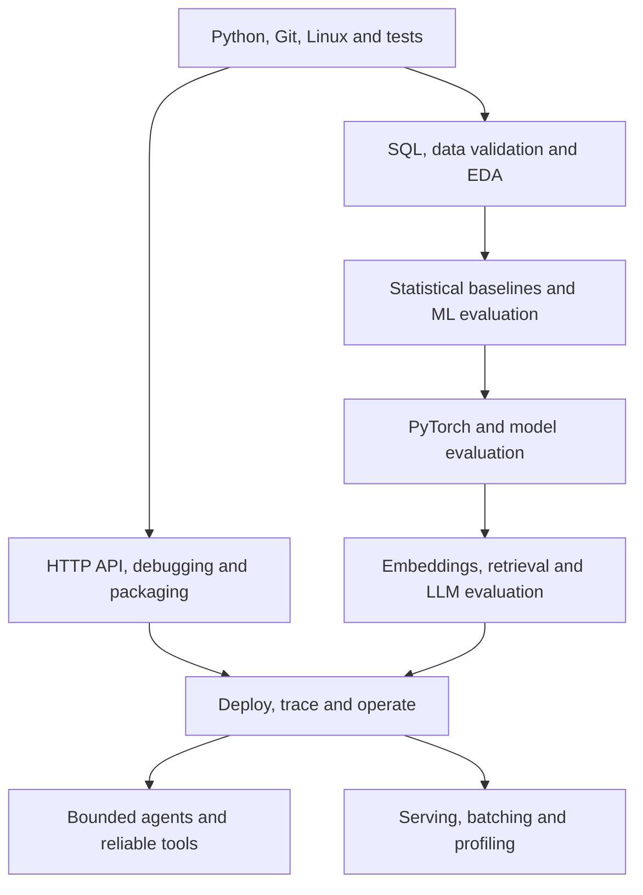

# From basic Python to an Applied AI or ML role by December 2027

**Soubhagya Jain · India-first search · December 2026 through December 2027**

## 1. Current job market analysis

**Research snapshot · 25 November 2026.** I reviewed public employer and applicant-tracking pages and sampled two startup listings with disclosed pay. The sample deliberately spans internships, junior jobs and experienced roles to show how the work and eligibility change. It is a qualitative sample, so use it to choose what to learn and which doors to try. Market-wide context comes from named surveys and trackers with different definitions.

### What the market evidence says

- **The Indian market includes early-career AI demand and is weighted toward experienced candidates.** Foundit’s 2025 tracker, as reported in January 2026, counted more than 2.9 lakh AI-linked postings, with 18% in the zero-to-three-year experience category. Python appeared in roughly three-quarters, and SQL and data engineering were sought in more than half of roles. The zero-to-three-year group includes people with experience, and postings measure advertised demand. The tracker’s 32% growth figure was a forecast for 2026. [Storyboard18 reporting on the foundit Insights Tracker](https://www.storyboard18.com/how-it-works/ai-roles-cross-2-9-lakh-in-2025-hiring-seen-up-32-in-2026-87532.htm)
- **Operating systems is part of the hiring signal.** TeamLease Digital’s FY2026–27 primer describes a premium for people who can build, run, secure and govern AI-enabled systems across its benchmark of 37,000 tech and digital roles in 18 Indian cities. The Stanford AI Index also reports broad international diffusion of AI engineering skills in its 2016–2025 data. These signals support learning deployment and evaluation. They cover broader populations than fresh-graduate AI hiring. [TeamLease Digital FY2026–27](https://business.teamleasedigital.com/digital-skills-and-salary-primer-2026-2027/) · [Stanford AI Index 2026](https://hai.stanford.edu/ai-index/2026-ai-index-report)
- **Coding tools change what you need to show.** DORA’s 2025 research describes AI as amplifying the strengths and weaknesses of the engineering system around it. In February 2026 METR reported that selection and measurement issues made its newer experiment a poor proxy for the current productivity effect. Neither study measures junior recruiting outcomes. For your preparation, independently specifying behavior, testing a change and debugging it are high-value ways to show ownership in an AI-assisted workflow. [DORA 2025](https://dora.dev/research/2025/dora-report/) · [METR February 2026](https://metr.org/blog/2026-02-24-uplift-update/)
- **Graduate hiring requires reading the whole listing.** In the sample, an Associate Data Scientist job specifies 0–1 years and a master’s. An Amazon Applied Scientist internship requires current enrollment, while Microsoft’s Applied Sciences Intern describes multiple qualification pathways, including equivalent experience. Search by job responsibilities and explicit eligibility as well as titles. [NielsenIQ](https://jobs.smartrecruiters.com/NielsenIQ/744000163147769-associate-data-scientist) · [Amazon](https://www.amazon.jobs/en/jobs/10477346/applied-scientist-i-intern-jan-2027-6-months) · [Microsoft](https://apply.careers.microsoft.com/careers/job/1970393556917519)

### Posting sample and what each role tests

Treat the pages as examples of hiring criteria at the snapshot date. Confirm live eligibility, dates and application status before applying. Pay is unstated in the reviewed text unless shown in the table. The two Wellfound examples are employer descriptions on a third-party board, with advertised figures and terms to clarify with a recruiter.

| Employer and role | Location and entry filter | Hiring signal or advertised pay |
|---|---|---|
| Drivetrain · Engineering Intern, Gen AI for FP&A Platform | Remote in India. Relevant degree underway or recently completed. | RAG, agents, LLMs, DSA, system design and end-to-end project evidence. [Role](https://jobs.lever.co/drivetrain/bc1c17bc-86ac-4f00-a1e3-0eb85aae4fdc) · [India application page](https://jobs.lever.co/drivetrain/bc1c17bc-86ac-4f00-a1e3-0eb85aae4fdc/apply) |
| Amazon · Applied Scientist I Intern, Jan 2027 (6 months) | India. Current enrollment in a relevant bachelor’s, master’s or PhD program. | Python preferred, practical ML and exposure to production model deployment. [Amazon](https://www.amazon.jobs/en/jobs/10477346/applied-scientist-i-intern-jan-2027-6-months) |
| Microsoft · Applied Sciences Intern | Multiple India locations. Degree and experience alternatives, including equivalent experience. | Large-dataset experiments, models formulated around product scenarios, scalable prototypes. [Microsoft](https://apply.careers.microsoft.com/careers/job/1970393556917519) |
| Artha Labs · Machine Learning Engineer | Bengaluru or eligible remote. The description lists 0–2 years or at least six months of industry-quality project experience. | Python, TensorFlow/PyTorch, robotics simulation and agentic development tools. Advertised ₹10–20 lakh and 0–0.5% equity. [Wellfound listing](https://wellfound.com/jobs/4844645-machine-learning-engineer) |
| Celex Technology · Machine Learning Engineer | Kolkata office. The listing shows one year of experience. | Strong Python and practical ML applied to operational problems. OCR and computer vision appear in the role. Advertised ₹6–8 lakh with no equity. [Wellfound listing](https://wellfound.com/jobs/4718613-machine-learning-engineer) |
| NielsenIQ · Associate Data Scientist | Pune. The qualifications list a relevant master’s and 0–1 years. | Statistics, Python, PySpark, SQL and cloud. [NielsenIQ](https://jobs.smartrecruiters.com/NielsenIQ/744000163147769-associate-data-scientist) |
| NVIDIA · Senior MLOps Engineer, DSX Enablement | Bengaluru, Hyderabad or Pune. 8+ years in technical roles. | Large-scale AI infrastructure, scripting and a systems language. Evidence for the platform specialization’s senior bar. [NVIDIA](https://nvidia.wd5.myworkdayjobs.com/en-US/NVIDIAExternalCareerSite/job/India-Bengaluru/Senior-MLOps-Engineer---DSX-Enablement_JR2024864-1) |
| G-P · Staff AI Engineer | Remote-first in India. 8+ years building and shipping ML systems. | Production Python, LLM/NLP services, metrics, traceability, monitoring and human review. [G-P](https://job-boards.greenhouse.io/globalizationpartners/jobs/7704105003) |
| Cohere · Machine Learning Intern/Co-op, Winter 2027 | Remote with locations listed as Canada, Europe, UK and US. Current enrollment and four-month availability. | Python and ML frameworks, training and serving. This posting’s location list affects who can apply. [Cohere](https://jobs.ashbyhq.com/cohere/36d1f52f-8270-4652-adf5-5303a0ff341b) |
| Observe.AI · AI Agent Engineer, Client Facing | Redwood City, California hybrid. 3+ years of related experience. | Client integration and deployment, programming and end-to-end delivery. US$108–170K annual base in its stated market. [Observe.AI](https://www.observe.ai/position?gh_jid=5254531008) |

### What I would bet on for 2027

| Planning judgment | Consequence for your roadmap |
|---|---|
| The durable Applied AI work will be integrating models with messy data and business systems, then measuring and operating the result. | Practice authorization, document provenance, structured outputs, eval sets, tracing, latency budgets and human escalation in one domain. |
| Basic prompting, standard API glue and demo-only chat interfaces will get cheaper to produce. They remain useful building blocks and carry less weight on a resume by themselves. | Show the decision you made, the baseline you beat, what failed, and how a reviewer can reproduce it. Learn framework interfaces and standard components in context. |
| Genuine junior MLE and Data Scientist entry points will vary by domain, city and degree filter. Dedicated serving, MLOps and agent titles will often expect more production experience. | Apply to junior AI and ML titles first. Use RAG, agents and inference as proof of breadth or depth. Read experience ranges and consider team-specific internships, off-cycle roles and graduate programs. |
| Remote access from India will remain narrower than the global count of remote jobs. | Use Indian startups, product teams and multinational India teams as the main funnel. Add employers that explicitly list India hires or contractors. Demonstrate asynchronous communication, readable pull requests and deployment ownership. |

These are forecasts for preparation. Refresh the evidence each quarter by coding a small sample of roles you are eligible for by title, experience, location, education and must-have skills. Compare counts inside that sample and adjust tactical electives if repeated patterns change.

## 2. Realistic assessment of the goal

**Aim to be ready for a June 2027 internship and able to compete for full-time Applied AI or junior ML roles in the second half of 2027.** Start internship applications in March, earlier if a campus cycle opens. Begin selective full-time applications in July once you can defend a deployed project and pass a practice screen. The deadline is December 2027, and recruitment dates will vary by employer.

At 30 hours a week, four scheduled weeks per month give you **1,560 hours** across 13 months. The 32 calendar days beyond those 52 weeks are available for degree exams, interview loops, illness, and recovery. Each scheduled week also reserves time for review or slippage. If your degree workload stays high for several weeks, move to the 20-hour plan and keep the same competency gates.

| Offer outcome | 2027 planning assumption | What would support it |
|---|---|---|
| Realistic | Around ₹7–12 LPA CTC is a reasonable working target for a first role, with offers possible below or above it | A strong internship or credible production-style project, clean Python and SQL screens, and openness to several Indian cities and employer types |
| Competitive | ₹12–20 LPA CTC is an ambitious search band for selective product firms, funded startups and stronger conversion offers | Distinctive, independently verifiable work, strong interviews, clear contribution and multiple active hiring conversations |
| Exceptional | ₹30–40 LPA CTC is a stretch target for a fresher. The ₹20–30 LPA range is also a high bar | Typically a particularly selective process, a strong internship, scarce evidence of skill, or compensation that includes significant bonus or equity |

These are planning bands, with only the survey anchor coming from TeamLease Digital’s FY2025–26 report on ₹7–8.5 LPA starting pay for AI and cloud freshers. The source does not establish national distributions by title or the likelihood of the upper bands. Evaluate annual fixed cash, variable pay, and equity separately. [TeamLease Digital salary primer](https://business.teamleasedigital.com/digital-skills-and-salary-primer-fy2025-26/)

**Use basic Python as the starting assumption.** If you already have working versions of Aperture RAG, AgentGate or Ridgepoint, use them as starting repositories. Earn credit by rebuilding a small representative component from a blank file, reproducing its key test or benchmark, and explaining the decisions. Your mathematics background can shorten review once you pass the diagnostics. State your degree and graduation status exactly as documented when applying. Internships may require active enrollment or a particular graduation window. If a posting accepts equivalent practical experience or places no enrollment condition, consider it on those terms.

## 3. Recommended specializations

| Priority | Target titles | Why and when |
|---|---|---|
| 1 | Applied AI Engineer, Junior AI Engineer, AI Engineering Intern | Primary path. Python services, domain data, retrieval, evals and deployment let you show a substantial system early. Use Document Intelligence and Applied AI Intern as search terms. |
| 2 | Machine Learning Engineer, Junior ML Engineer, ML Engineer Intern | Secondary path. Add classical ML, feature pipelines, model evaluation and service operation. It expands your search across AI startups, product teams and larger employers. |
| 3 | LLM Engineer, Generative AI Engineer | Apply in parallel when the description matches retrieval, document AI, evals or product integration and the seniority fits. |
| 4 | Data Scientist, Associate Data Scientist | Apply selectively to analytics-heavy junior roles. This path raises the SQL, statistics, experimentation and stakeholder communication bar. Use independent stats/SQL gates and a decision memo to establish fit. |
| 5 | AI Agent Engineer | Search for this title after you can demonstrate a bounded workflow, mocked tool failures, regression checks and approval rules. Similar work can appear under Applied AI. |
| 6 | MLOps Engineer, ML Systems Engineer | Stretch paths for the first job. Apply to true junior roles after demonstrating deployment and rollback for MLOps, or a rigorous inference benchmark for systems. Use these skills to differentiate an Applied AI or MLE application meanwhile. |

This order balances fit, barriers to a first job, earning upside, and durable skills. Several labels overlap, so screen the work and eligibility before deciding whether to apply. Compensation is employer- and level-specific. The specialization is **production Applied AI for document and knowledge workflows**, backed by **classical ML and deployment**.

## 4. Skill dependency map

Study probability, gradients and linear algebra alongside the first place you will use them. Begin interviews and applications while the technical branches are still in progress.

## 5. Skill prioritization matrix

**P0** means hiring-critical for the recommended primary or secondary role. **P1** gives a strong edge. **P2** differentiates once the core works. **P3** means recognize or defer. Hours are approximate focused learning and drills for one pass, with project and interview time budgeted separately. Practice overlaps across topics, so use the monthly quotas as the controlling budget. Interview priority is for Applied AI or MLE unless specified.

| Skill and priority | Demonstrable depth and application | Hours | Prerequisite | Interview and AI use |
|---|---|---:|---|---|
| P0 Python, OOP, standard library, typing | Write modules, parse CSV/JSON, choose classes or functions, handle exceptions and structure a package. Comfortable with iterators, context managers and dependency boundaries. | 65–85 | Basic syntax | High. Draft scaffolding after an independent attempt. Own runtime behavior. |
| P0 Git, Linux, shell, pytest, debugging | Reproduce a failing run, inspect logs, isolate a defect, write a regression test, use a branch and review a diff. | 45–60 | Python basics | High. AI can propose hypotheses. You prove them. |
| P0 SQL | Joins, grouping, CTEs, windows, deduplication, nulls and row grain. Read a simple query plan and explain an index. | 55–70 | Tabular reasoning | High for ML/data and very high for DS. Repeat problems unaided. |
| P0 NumPy, pandas, EDA, visualization, ETL and data quality | Array shapes and broadcasting, timestamps, plotting and joins at the correct grain. Build a rerunnable data load with schema and leakage checks. | 55–70 | Python and SQL basics | High. AI can draft plots. Check distributions and schema. |
| P0 Probability, linear algebra, stats, calculus and optimization | Dot product, norm, cosine, matrix multiplication, gradients/chain rule, conditional probability, variance, sampling, uncertainty and regularization. Apply to model errors and embeddings. | 65–85 | Algebra | High. Work small examples and derivations unaided. |
| P0 Classical ML and evaluation | Dummy, linear/logistic, tree and random forest, boosted models, preprocessing pipelines, split strategy, cross-validation, imbalance, metrics, calibration, thresholds and slice error analysis. Compare experiments. | 85–110 | SQL/data and applied math | High. AI can generate an experiment scaffold. You choose the split and metric. |
| P0 REST, FastAPI, design and async fundamentals | Validated requests, response contracts, timeouts, batching, background work and logging. Distinguish CPU-bound work from I/O and use a queue only when workload warrants it. | 45–60 | Python, HTTP, testing | High. Generate boilerplate after defining the contract. |
| P0 Docker, GitHub Actions, deployment and observability | Build an image, run CI, configure one deployment, handle secrets, expose health, record latency and errors, and rehearse rollback. | 45–65 | API and Git | High. Verify YAML and IAM permissions against docs. |
| P0 Applied LLM engineering | Tokenization, embeddings, prompt/context design, structured outputs, one vector index, sparse+dense retrieval, reranking, answer evaluation, abstention, input trust and citation validation. | 85–110 | API, eval metrics, vector math | High. AI can write adapters. Own the eval set and review labels. |
| P1 Data structures and algorithms | Arrays, strings, hashing, two pointers, stacks, queues, binary search, trees, BFS/DFS, heaps and basic intervals. State time and space complexity in Python. P0 for many general SWE-style loops. | 65–90 | Python | Medium to high by employer. Solve first with assistance disabled. |
| P1 Stats and experimentation | Confidence intervals, hypothesis tests, effect size, power intuition, design randomization and experiment guardrails. P0 for product DS. | 35–55 | Probability and SQL | High for DS. Explain design, assumptions and business trade-offs. |
| P1 Feature engineering, explainability and model breadth | XGBoost **or** LightGBM, then a brief comparison with the other. Practice feature ablation, permutation importance, PCA and clustering for a real question. | 35–50 | Classical ML | Medium to high for MLE/DS. Verify explanations on held-out data. |
| P1 PyTorch, neural nets and transfer learning | Train and debug a small model. Explain logits, losses, backprop, optimizer behavior, checkpoints and CNNs. Understand RNN/LSTM at diagram level. | 65–85 | Applied math and evaluation | High for MLE with deep learning. Use AI as a reviewer for tensor shapes and failure hypotheses. |
| P1 Transformers and practical GPU use | Sketch attention, masks, positional information, prefill and decode. Profile basic GPU memory and throughput. Distinguish FP16/BF16/quantized storage. | 35–55 | PyTorch and vector math | High for LLM roles. Calculations and measurement stay yours. |
| P1 Agent workflows and evals | Typed tools, bounded steps, retry rules, idempotency, state, approvals, offline evals and tracing. Use one workflow library only if useful. P0 for agent-heavy roles. | 50–70 | API, data contracts, LLM evals | High for applied LLM. Test tool failures and policy behavior yourself. |
| P1 One cloud, experiment tracking, versions and queues | Deploy to one AWS or GCP service, track with MLflow or simple versioned manifests, describe IAM/storage, and demonstrate rollback. Redis and a queue only for measurable needs. | 45–65 | Docker, CI, observability | Medium to high. Verify actual deployment and costs. |
| P1 AI system design and reliability | Estimate load, choose sync vs async, define quality/latency targets, bound faults and design monitoring or replay. | 35–55 | One service and project | High for startups and mid-level-style loops. Whiteboard unaided. |
| P2 Advanced retrieval, LoRA/QLoRA, multimodal | Run one evidence-led experiment. Use label scarcity and error slices to decide between OCR/layout features, retrieval fixes, or fine-tuning. | 25–45 | Retrieval, PyTorch and a baseline | Medium. Keep a held-out set and profile memory. |
| P2 Model serving and inference | Benchmark a small model, explain KV cache, prefix caching, continuous batching and speculative decoding. Implement one change or compare two serving configurations. | 40–70 | Transformers, GPU basics and observability | High for systems roles. Fix trace, model, hardware and outputs before testing. |
| P2 MCP, durable workflows, Kubernetes, distributed training basics | Demonstrate one read-only MCP integration or failure-safe job. Explain pods, services, rollouts, data parallelism, checkpointing and bottlenecks at an introductory level. | 20–40 elective | Tools and deployment fundamentals | Team-specific. Read the docs and reproduce basic behavior. |
| P3 Polars depth, numerical methods, information theory, deep RNN/LSTM, multi-agent, distributed GPU training | Learn enough to recognize use cases. Work on one elective when a role or measured bottleneck makes it relevant. | 0–20 elective | Relevant core skills | Low for the primary lane. Look up specific APIs when needed. |

Put custom CUDA kernels, training large foundation models from scratch, Kubernetes certifications, a second cloud, advanced competitive programming, vendor-specific prompt certificates and deep dives into multiple orchestration frameworks outside the default plan. Learn cross-entropy as a loss before studying information theory formally. For numerical methods, cover stability, dtype and good floating-point checks early. Other material can wait for a concrete need.

### What proficiency looks like in practice

| Subject | Understand | Build from scratch | Build with libraries | Explain in an interview | Deploy or operate |
|---|---|---|---|---|---|
| Python and software | Types, data flow, exceptions, modules, concurrency boundaries | CLI parser, validator, isolated bug fix | pytest, FastAPI, logging | Trade-off, failure path and complexity | Packaged, tested service or CLI |
| Data and SQL | Grain, missingness, join fan-out, split leakage | Hand-check a join and confusion matrix | SQL engine, pandas, NumPy | Trace row counts and identify leakage | Validated scheduled or rerunnable ETL |
| Math and stats | Vector math, conditional probability, gradients, uncertainty | Tiny gradient descent, statistic or permutation test | NumPy/scipy or stats library | Interpret effect size, denominator and assumptions | Put thresholds and metric definitions in versioned evaluation |
| Classical ML | Bias/variance, baseline, validation and calibration | Logistic loss/gradient or a shallow split criterion | scikit-learn and one boosting package | Choose split, model and threshold given costs | Versioned scoring API and rollback |
| Deep learning | Autograd, losses, optimization and overfitting | Tiny MLP backward step or one attention head | PyTorch training loop and checkpoint | Debug a flat loss curve and trace tensor shapes | Serve one small model or artifact |
| LLM/RAG | Retrieval vs generation errors, token budget, structured outputs | Cosine top-k and a small citation-checking function | Tokenizer, embedding model and index | Defend ranking metrics, abstention and evidence policy | Traced service with repeatable offline eval |
| Agents | State, tool authority, stopping, retries and approval | Small explicit state machine and trace replay | Typed tool schemas, optionally one orchestrator | Walk through a timed-out or duplicate action | Bounded workflow with deterministic tests |
| Deployment and ML systems | Resource limits, queues, scaling and latency percentiles | Tiny load harness with warm-up and percentile calculation | Docker, CI, one cloud, optional vLLM | Separate queueing, prefill and decode effects | Health checks, resource limits, dashboards and rollback |

## 6. Complete 13-month roadmap

### Hours and calendar

Use four seven-day blocks starting on the first of each month. Treat days 29 through month-end as flex dates. Each week ends with a working artifact, an oral explanation, or a timed test. Project hours include hands-on learning when it directly produces project work. Each month has a hands-on gate before the next dependent feature.

| Scenario | Per scheduled week | 13-month scheduled total | How to adjust |
|---|---|---:|---|
| 20 h/wk | 5h learn, 8h build, 4h interview, 1h search, 2h review/buffer | 1,040h | Ship classifier, RAG/doc AI and one applied extension. Implement a compact version of an evaluation gate. Defer dedicated serving work, stream pipeline and fine-tuning. Keep application start dates. |
| **30 h/wk** | **7h learn, 12h build, 5h interview, 3h search, 3h review/buffer** | **1,560h** | Four scheduled weeks per month at 120h. Complete three core portfolio systems and one serving or pipeline project if gates are met. |
| 40 h/wk | 8h learn, 18h build, 7h interview, 3h search, 4h review/buffer | 2,080h | Add the fifth project or a serious OSS contribution. Prefer larger eval sets, real feedback, repeated benchmarks and higher-quality interview practice. |

Before March, spend the search portion on market reading, role research, README work and internship eligibility. From July, move 3–4h/week from learning/building into outreach and interview loops when the pipeline needs it. At 20h the first 4–5h to cut come from electives and polishing. Keep a rest day and use flex dates for degree exams.

| Month and resources from §9 | Four weekly blocks | Practical deliverable, mock interview and monthly gate |
|---|---|---|
| **Dec 2026 · 120h** · CS50P, Pro Git, SQLBolt, MIT Missing Semester | **W1** Python/Git/Linux diagnostic, functions and tests. **W2** validation CLI, type hints, errors, file I/O. **W3** SQL joins, aggregation, nulls and dataset profiling. **W4** package CLI, CI, written handoff and independent rebuild. | Data-quality CLI with 12 meaningful tests and CI. Mock a 35-minute Python task plus two joins. Pass if at least 8/10 timed SQL basics, tests pass, and you can repair a deliberately broken validation rule unaided. |
| **Jan 2027 · 120h** · NumPy, pandas, ISLP, Mathematics for ML | **W1** shapes, dot products and transforms. **W2** probability, sampling, variance and EDA. **W3** SQL windows, cohort logic, Pandas merges, date splits. **W4** implement logistic gradient descent, use a dummy/linear baseline and write an error analysis. | One notebook/report with reproducible public data and a clean split. Mock statistics and SQL for 45 minutes. Pass 3/4 unseen SQL tasks and explain a join fan-out, a confusion matrix and the effect of changing a decision threshold. |
| **Feb · 120h** · ISLP, FastAPI, Docker | **W1** sklearn pipelines, trees, random forest, one boosting model, validation. **W2** calibration, imbalanced metrics, thresholds and slices. **W3** FastAPI endpoint, integration tests, versioned artifacts. **W4** Docker packaging, rolling back an artifact and limit/load tests. | Project 1 v1 with baseline, time split, slices and runnable service. Mock ML theory plus model review. Pass by reproducing the report from a clean checkout, catching leakage, and explaining model selection, threshold and rollback. |
| **Mar · 120h** · PyTorch Basics, HF LLM Course, FSDL | **W1** tensors, loss, backprop and an overfit-on-one-batch check. **W2** CNN/transfer learning primer, tokens and one masked attention head. **W3** build RAG corpus, answer/evidence annotations and lexical baseline. **W4** dense retrieval, trace instrumentation and a short public demo. | Project 2 baseline plus 25 development queries. Mock tensor/debug questions and a project walkthrough. Pass if you can diagnose a learning bug and classify five traced RAG errors by ingestion, retrieval, or generation. Begin internship outreach. |
| **Apr · 120h** · FSDL, HF LLM Course, OWASP GenAI | **W1** response schemas, citation mapping and query fetch. **W2** hybrid retrieval, fixed split and reranker experiments. **W3** OCR/noisy PDF slice, citations, abstention and data access rules. **W4** freeze holdout, publish eval results, add reproducible container and demo. | Project 2 v1, at least 60 labeled questions and one ablation. Mock a 45-minute RAG design plus failure analysis. Pass if sources and abstention are evaluated, measured deltas are reproducible, and you can show where the system fails. |
| **May · 120h** · Anthropic agents, MCP intro, Docker, GitHub Actions | **W1** deterministic document review workflow and schemas. **W2** typed, bounded tool calling and simulated failures. **W3** traces, regression cases and approval logic. **W4** timed take-home, two mock screens, two project walkthroughs, heavy application push. | Project 3 prototype, 20 deterministic tests and a visible failure path. Pass two mocks with the §12 rubric and a clean demo. Add one cloud deployment for Project 1 or 2 if feasible using synthetic or public data. |
| **Jun · 120h** · GitHub Actions, ECS docs, FSDL eval | **W1** expand fixtures and task/diff evaluation. **W2** CI gate, failure reporting and versioned trajectories. **W3** escalation, timeouts and recovery drill. **W4** internship onboarding or public-feedback sprint with a written bug fix and measurable result. | Internship-ready gate by week 1 if May is complete. Mock a debugging screen, repo demo and behavioral round. Pass if a reviewer can reproduce your CI failure and recovery and you can summarize two systems in 90 seconds each. |
| **Jul · 120h** · vLLM docs, PyTorch Basics, GitHub Actions | **W1** model loading, context/KV arithmetic and simple profiling. **W2** fixed-trace TTFT, inter-token latency and peak VRAM benchmark. **W3** compare baseline vs one batching/cache change, repeat and analyze. **W4** write a benchmark report and an ML service design. | Project 4 baseline or an extra evaluation sprint on Project 2 if you lack time. Mock API design and latency debugging. Pass if median/p95 results repeat under documented settings and output quality is checked. Open targeted full-time applications. |
| **Aug · 120h** · PostgreSQL tutorial, MLflow, ECS docs | **W1** serving configs, queue/backpressure, retries and metrics. **W2** build one failure and recovery test. **W3** choose Ridgepoint benchmark polish or event pipeline v1. **W4** one upstream PR or review, rerun demos and application packet. | One scoped production improvement. Mock a 90-minute take-home excerpt and a 45-minute system design. Pass if recovery preserves correctness and you can explain one throughput/cost trade-off. |
| **Sep · 120h** · ISLP, PostgreSQL, Khan Academy statistics | **W1** advanced SQL drills and data definitions. **W2** experiment design or an Applied AI quality A/B simulation. **W3** two project deep dives, CI hygiene and one held-out benchmark. **W4** applications for autumn graduate and startup hiring, peer mock. | Product decision memo and pipeline or serving result if in scope. Pass an unseen SQL set and defend sample choice, statistical uncertainty and metric stability. |
| **Oct · 120h** · LeetCode, vLLM or FSDL, project docs | **W1** Python DSA patterns under time. **W2** one ML design and one LLM design case. **W3** complex debugging and load testing. **W4** multiple mock screens, one behavioral loop, resume refinement from response data. | Application-ready portfolio with three pinned projects. Pass two scored mocks, including one independent timed code session and one service design. |
| **Nov · 120h** · Use reference sections only where errors recur | **W1** close strongest recurring gap. **W2** rehearse one take-home in a small repo. **W3** stress-test demos, rollback and deployment docs. **W4** follow up on active applications, do offer-comparison prep and one full mock loop. | One externally reviewed project improvement and an application conversion report. Pass an independent reproduction plus two mock rounds with no central gap recurring. |
| **Dec · 120h** · Targeted references from §9 | **W1** recap weak projects and prepare new openings. **W2** recruiter, design and behavioral loops. **W3** evaluate and negotiate offers when available. **W4** maintain funnel and triage next hiring cycle if still searching. | Updated one-page resume, verifiable portfolio and evidence for target role. Re-run Python, SQL, system design and project walkthrough gates. Use outcomes to decide whether to broaden titles or focus on deeper interviews. |

If an internship starts, treat authorized internship work as the build block and keep a few hours of interviews and review. Use only independently reproducible public or approved material in your portfolio.

## 7. Detailed weekly plan for the first 30 days

**Dates are December 1–30, 2026.** Work six five-hour days per week. Rest on days 7, 14, 21 and 28. Reuse a public complaint-data sample of roughly 5,000 rows. Scope the CLI to schema checks, malformed dates, duplicate IDs, missing labels and safe aggregate reporting.

| Days | Actions and exercises | Checkpoint |
|---|---|---|
| **1–7** · 30h | D1 take a closed-book Python/SQL diagnostic and initialize the repo. D2 build and test functions that parse dates and normalize one field. D3 practice dict/list/set and tally issues. D4 use a branch and debug a broken CSV. D5 write pytest cases for valid, missing and malformed input. D6 run a 35-minute mock and record weak spots. D7 rest. | Parse a small fixture, read a traceback, make a scoped commit and explain O(n) time and auxiliary space for the tally. |
| **8–14** · 30h | D8 package the CLI with a clear entry point. D9 use type hints and introduce exceptions for invalid input. D10 use `pathlib` and structured JSON reporting. D11 add deduplication and validate schemas without mutating input. D12 cover empty files, missing columns and malformed rows. D13 rebuild the entry point without AI and write a short README. D14 rest. | A fresh environment can run the CLI and tests. Invalid input produces useful errors and status codes. |
| **15–21** · 30h | D15 create a local SQLite or DuckDB table. D16 write filter, grouping and conditional aggregate queries. D17 compare LEFT/INNER joins and deliberately create duplicate-key fan-out. D18 use a CTE and `ROW_NUMBER` for deduplication. D19 use pandas to independently cross-check five aggregates. D20 solve four timed SQL tasks and review mistakes. D21 rest. | In 45 minutes, solve at least three of four unseen tasks or review and retake. Explain row counts before and after every join. |
| **22–28** · 30h | D22 separate ingestion, validation and reporting. D23 add edge-case tests and GitHub Actions. D24 add deterministic fixtures and dependency instructions. D25 run and document release from fresh checkout. D26 fix one bug introduced by a peer or by an earlier commit. D27 record a two-minute demo and take the December gate. D28 rest. | CI green, at least 12 tests across meaningful behaviors, two-minute demo, 8/10 timed SQL basics, and an independently fixed regression. |
| **29–30** · flex | Spend up to 4h total retaking the weakest skill gate or writing January’s dataset split and baseline plan. Keep the rest available for exams or recovery. | Write three next actions and save a clean starting commit for January. |

For DSA use Python. For each attempted problem write the invariant, edge cases, time and auxiliary space complexity, and one alternative. Re-solve a failed problem from memory 48 hours later.

## 8. Daily study schedule and learning method

### Default five-hour working day

| Block | Duration | What to do |
|---|---:|---|
| Retrieval practice | 20 min | From a blank page explain one older topic and solve a tiny example. |
| New concept | 50 min | Read or watch a targeted section. Predict an outcome before running code. |
| Implementation | 120 min | Implement one thin slice with a failing example, then debug it. |
| Testing, evaluation or write-up | 40 min | Add a fixture, review an error slice, or publish the benchmark method. |
| Interview block | 50 min | Python DSA, SQL, ML math or a spoken design drill. |
| Search and review | 20 min | Log evidence, read a job description, refine an application or note next work. |

Take short breaks between blocks, outside the five focused hours. Move the blocks around classes or work. At 20h use five four-hour days. At 40h use six roughly 6h40m days and make the extra time build/feedback work. Keep one day off at each level. These daily blocks are a template. Follow the monthly weekly category quotas by swapping blocks when needed.

### Independent learning loop

1. **Attempt first.** Predict inputs, outputs and likely failure cases. Spend 20–30 minutes on a concrete attempt before asking for help. For a bug, reproduce, shrink, inspect, form a hypothesis and test it.
2. **Ask for the smallest useful hint.** Use ChatGPT or Claude for a counterexample, a question about your reasoning or a review of your tests. Use coding agents for scoped work after writing acceptance criteria and marking files they may change. Review diffs, rerun tests, and explain any suggestion you keep. Use synthetic snippets for tools when project data is private.
3. **Rebuild and explain.** For each concept, implement a minimal version, use a library in a deliverable and explain assumptions aloud. Read real library or project code for one narrow question once weekly. Every Friday take a 30–60 minute no-AI challenge, including for tool-assisted features.
4. **Space and interleave.** Review at approximately 1, 3, 7, 14 and 30 days. Rotate two interview domains and one build topic each week. Retrieval prompts should require reconstructing a decision or deriving a result.
5. **Audit dependence.** Keep a log of what you attempted, which hint you used and how you verified it. Limit passive material to roughly one quarter of scheduled study. Finish each learning block with a small diff, query, derivation or scored explanation. Read the next lesson once the current lesson has produced evidence you can reproduce.

## 9. Curated learning resources

Pages below were checked in November 2026. Use the specified units as needed. The core materials are freely accessible, and some hosts also sell certificates or premium problems.

| Subject | Primary resource and scope | Supplement when needed |
|---|---|---|
| Python and testing | [Harvard CS50P](https://cs50.harvard.edu/python/) · functions, exceptions, unit tests, file I/O, regular expressions and OOP | — |
| Git and Linux | [The Missing Semester of Your CS Education](https://missing.csail.mit.edu/) · shell, development tools and debugging | [Pro Git](https://git-scm.com/book/en/v2) · branching and resolving conflicts |
| SQL | [SQLBolt](https://sqlbolt.com/) · introductory exercises | [PostgreSQL window-functions tutorial](https://www.postgresql.org/docs/current/tutorial-window.html) · analytic queries |
| Data and arrays | [pandas getting-started tutorials](https://pandas.pydata.org/docs/getting_started/intro_tutorials/) · input, joins, aggregation and plotting | [NumPy learning resources](https://numpy.org/learn/) · array shapes, broadcasting and indexing |
| Linear algebra and calculus | [Mathematics for Machine Learning](https://mml-book.github.io/) · vectors, matrices, projections, derivatives and optimization | — |
| Probability and inference | [Khan Academy Statistics and Probability](https://www.khanacademy.org/math/statistics-probability) · probability, sampling, confidence intervals and tests | — |
| Classical ML | [An Introduction to Statistical Learning with Python](https://www.statlearning.com/) · regression, classification, resampling, trees and labs | — |
| Python interview DSA | [LeetCode Top Interview 150](https://leetcode.com/studyplan/top-interview-150/) · select problems by pattern and use the free exercises | — |
| Deep learning | [PyTorch Learn the Basics](https://docs.pytorch.org/tutorials/beginner/basics/intro.html) · tensors, datasets, autograd and optimization | — |
| Transformers and tokenization | [Hugging Face LLM Course](https://huggingface.co/learn/llm-course/chapter1/1) · start with chapters 1–3 | — |
| RAG and applied LLM systems | [Full Stack LLM Bootcamp](https://fullstackdeeplearning.com/llm-bootcamp/) · augmented LMs, UX and LLMOps. Use the architecture and evaluation concepts from these 2023 lectures. | [Building a Generative AI Platform](https://huyenchip.com/2024/07/25/genai-platform.html) · architecture overview |
| Vector storage and retrieval | [pgvector](https://github.com/pgvector/pgvector) · use SQL filters in similarity search when PostgreSQL fits the project | [Original RAG paper](https://arxiv.org/abs/2005.11401) · review the retrieval/generation interface if you want the research background |
| Agents and MCP | [Anthropic, Building Effective Agents](https://www.anthropic.com/research/building-effective-agents) · workflow and agent design patterns | [MCP introduction](https://modelcontextprotocol.io/docs/getting-started/intro) · specification concepts and integration |
| LLM security | [OWASP Top 10 for LLM Applications](https://genai.owasp.org/llm-top-10/) · map trust boundaries, output handling, retrieval access and resource controls | — |
| Services | [FastAPI tutorial](https://fastapi.tiangolo.com/tutorial/) · models, errors, dependencies and tests | — |
| Containers and CI | [Docker Learn](https://docs.docker.com/learn/) · image, container, logs and resource limits | [GitHub Actions docs](https://docs.github.com/en/actions) · CI workflows and artifacts |
| Cloud deployment | [Amazon ECS getting started](https://docs.aws.amazon.com/AmazonECS/latest/developerguide/getting-started.html) · one containerized service | — |
| Experiment tracking | [MLflow documentation](https://mlflow.org/docs/latest/) · track parameters, versions and eval artifacts | — |
| Inference and serving | [vLLM documentation](https://docs.vllm.ai/en/stable/) · metrics and serving parameters | [PagedAttention paper](https://arxiv.org/abs/2309.06180) · KV-cache design |

## 10. Production-grade project portfolio

**Ship Projects 1–3. Choose Project 4 as your optional flagship if you want inference work, or Project 5 if you want backend and MLOps work.** At 40h/week, do both if the core projects and job search are current. At 20h/week, keep Project 3 narrow and combine it with Project 2’s CI. Upgrade your existing repositories where useful. The hours below are planned build time allocated from §6, and all numerical release criteria are proposed targets. Report actual measurements and uncertainty in public.

For every repository, include a one-command local path or clear equivalent, tested instructions, architecture and failure-path diagrams, dependency/version lock, dataset origin and license or usage notes, split definitions, baseline, evaluation outputs, CI status, hardware assumptions, and a short recorded demo. Document where the demo runs, limits of the supported inputs, secrets and data handling, operating costs if applicable, and how to reproduce or roll back a release. Use synthetic/public data in demos and load testing. Report both what worked and one reproducible failure.

### Project 1 · Complaint routing and human triage · 80–105h · February release

- **Problem and architecture.** Route an incoming complaint into a queue and abstain on uncertain cases. Public data export → typed validator → temporal split → sklearn training/eval → versioned artifacts → FastAPI prediction → logs and review. Use DuckDB or SQLite for exploration and pandas for preprocessing. Deploy a container locally or as a small demo service.
- **Data and milestones.** Use a capped public CFPB complaint sample. Use the text and target product/category labels under a documented taxonomy. Exclude post-submission fields and audit duplicates or templated narratives before splitting by date. M1 validate and document data, M2 compare majority and TF–IDF/logistic baselines to a tree/boosting pipeline on suitable features, M3 calibrate/choose threshold on development data, M4 deploy and exercise rollback. Prefer simple text models if they win. [CFPB complaint database and caveats](https://www.consumerfinance.gov/data-research/consumer-complaints/)
- **Evaluate.** Measure macro-F1, per-class recall, coverage vs accepted-item accuracy, cost-weighted errors and p95 API latency at a declared load. Compare against a majority baseline and a simple lexical or linear baseline on a held-out later window. Show confusion pairs, minority-class results, delayed labels and domain-shift slices. Add bootstrap intervals or uncertainty notes where sample sizes permit.
- **Reliability and security.** Test empty input, novel labels, unexpected length, missing artifacts, duplicate IDs in data, stability on a frozen fixture and artifact rollback. Keep operational logs limited to metadata and aggregate counters. Restrict upload size and use rate limits on any public demo. Document an alert and fallback route for unusual label or abstain-rate shifts.
- **README proof.** One model card, time-split table, threshold/coverage plot, a reproducible sklearn pipeline, clean-room reproduction and a rollback sequence.
- **Resume bullet after measuring.** “Shipped a versioned complaint-routing service with [measured macro-F1] on a later-period holdout and [measured p95] at [load], with abstention and artifact rollback.”
- **Interview questions.** Which columns leak? Why did a simple baseline win or lose? How would you choose a threshold when review capacity is fixed?

### Project 2 · Document intelligence and citation-grounded RAG · 115–145h through follow-up work · April first release

- **Problem and architecture.** Find defensible answers in policy or operations documents with page-level evidence. Chunked page-aware ingestion → sparse and dense indices → rank fusion → optional reranking → typed generation and citation validation → abstain/answer → trace. Start with text PDFs and add a small OCR/layout slice. Use PyMuPDF or another reader consistent with the document license, a CPU embedding model, a small local model with constrained context and an optional hosted adapter.
- **Data and milestones.** Start with approximately 20–30 public or self-authored documents whose reuse terms you document. Include conflicting versions, unanswerable questions, tables, and a small set of noisy scans, with expected evidence spans. Aim for 60–100 labeled questions, with a locked holdout grouped by document family. M1 lexical retrieval, M2 dense/hybrid ablation, M3 cite/abstain behavior and OCR slice, M4 deployment and reproduction. Use FUNSD only for a separate form extraction/OCR experiment and follow its usage terms. [FUNSD](https://guillaumejaume.github.io/FUNSD/)
- **Evaluate.** Track evidence hit rate at a defined k, MRR or nDCG when appropriate, citation correctness at the claim level, unsupported-claim and unanswerable false-answer rates, OCR word error rate on a small transcription slice, and p50/p95 time to first token and total response time. Keep baselines and ablations on the same holdout and publish changes in both quality and latency.
- **Reliability and security.** Treat input documents as untrusted, enforce access before retrieval, keep source authorization through citation assembly, and reject unsupported evidence with deterministic tests or annotated review. Exercise partially failed ingestion, stale version, malformed PDFs, conflicting policy dates, and missing evidence. Use authenticated ingestion, minimal logging and synthetic or public demo content.
- **README proof.** Add a documented fixture corpus, label schema, one eval command, retrieval and generation failure examples, an ablation table, and a two-minute traced demo. Aperture RAG can serve as the starting repo if available.
- **Resume bullet after measuring.** “Built a page-cited policy assistant. Improved evidence hit@5 from [A] to [B] across [N] held-out questions and reported abstention, citation validity and p95 latency.”
- **Interview questions.** Why rerank at this k? How do you classify a wrong answer with a correct retrieval hit? What happens when the best evidence is obsolete or restricted?

### Project 3 · Bounded review workflow and CI evaluation gate · 90–115h · June release

- **Problem and architecture.** Review incoming forms and route ambiguous cases to a human. Compare a deterministic form pipeline to a model-assisted decision stage. Validated case → state machine → schema-constrained tool call → policy and approval check → idempotent action record → trace → offline evaluator → GitHub Actions. Use Python, Pydantic, pytest, structured JSON traces and a small local generator. External actions can be simulated with an in-memory or SQLite ledger. AgentGate can serve as the starting repo if available.
- **Data and milestones.** Start with 20 deterministic scenarios and grow to 50 synthetic scenarios covering correct tasks, ambiguous cases, invalid output, timeouts, duplicate requests and permission boundaries. M1 deterministic baseline and explicit state, M2 bounded tools with timeout/retry fixtures, M3 score traces and CI report, M4 version prompts and evaluate a deliberate regression. Repeat critical cases across controlled runs for model variability. Use a small deterministic suite for every PR and run slower model comparisons separately when needed.
- **Evaluate.** Track task success, policy compliance, unnecessary calls, duplicate side effects, review rate, p95 duration, and tokens/cost when available. Baseline one controlled model comparison and report raw counts with uncertainty. A sample gate requires at least 90% task success in deterministic tests and zero observed severe policy failures on reviewed critical fixtures. Zero observed failures in the suite gives limited evidence outside it.
- **Reliability and security.** Mock tool timeouts, malformed arguments, stale state, retries after completion and interrupted approvals. Keep tools deny-by-default and behind an explicit policy check. Require user approval for side-effectful demo actions and bound execution by calls, wall time and tokens. Keep tool secrets out of traces. Demonstrate with test fixtures and an isolated demo account or local simulation.
- **README proof.** Include instruction variants, failure traces, grading rules, action schema, one CI log showing a regression block and one showing recovery.
- **Resume bullet after measuring.** “Built a CI gate for AI workflow changes across [N] scenarios and [R] runs per candidate. Detected [observed regression] using deterministic policy checks and trace diffs.”
- **Interview questions.** Why is the workflow deterministic at the outer layer? How do you make a retried action safe? How does evaluation separate model error from a broken tool?

### Project 4 · Inference service and benchmark on the RTX 4050 · 60–95h · elective

- **Problem and architecture.** Improve response speed or concurrency for a small chat service under a fixed VRAM budget. Recorded synthetic request schedule → load generator → reference runtime → controlled candidate configuration → metrics and replay. Start with an approximately 1–1.5B model, fixed decode policy and modest contexts. Use PyTorch or your existing Ridgepoint runtime as the baseline and adopt vLLM only if your environment supports it. Compare one lever at a time, such as controlled batching or prefix reuse.
- **Data and milestones.** Use versioned request traces with two prompt-length classes, output lengths and concurrent arrivals. Reuse fixed expected text or tolerances for a smoke test. M1 VRAM budget and cold/warm baseline, M2 implement trace replay and one change, M3 collect repeated same-trace measurements, M4 document failure behavior and ship a local service/demo. [Qwen2.5-1.5B-Instruct model card](https://huggingface.co/Qwen/Qwen2.5-1.5B-Instruct)
- **Evaluate.** Track throughput, TTFT, inter-token latency, end-to-end p50/p95, peak allocated/reserved GPU memory, timeouts and output correctness. Keep hardware, driver, runtime, model/dtype, trace, warm-up, tokenization and sampling settings fixed. Publish raw samples or artifacts and a paired summary. If runtime differences prevent a fair comparison, use a single runtime baseline and record that scope.
- **Reliability and security.** Test mixed inputs, cancellation where supported, service overload, expired request, cache isolation and controlled OOM handling. Reject oversized inputs, bound queue/admission and avoid logging prompts. A stable local run and clear installation instructions are sufficient for this portfolio project.
- **README proof.** Add one command to replay the trace, versions, a table with confidence or run-to-run variation, and a memory budget split among weights, cache and runtime overhead.
- **Resume bullet after measuring.** “Benchmarked [model/runtime] on a 6 GB RTX 4050 using [fixed trace]. Improved [measured metric] from [A] to [B] while preserving [defined output check].”
- **Interview questions.** What part of p95 is queue delay? Why does GQA change KV size? Where does cache reuse stop paying off, or introduce an isolation concern?

### Project 5 · Recoverable event ingestion and ML scoring · 60–85h · elective

- **Problem and architecture.** Process complaint events into model scores without silently dropping, duplicating or publishing stale decisions. Replay a synthetic event stream that references sanitized held-out samples → Postgres event/outbox tables → Python worker → versioned model → score table → health and monitoring. Start with one worker and a simple pull loop. Add Redis or a broker only when a measurement or requirement warrants it.
- **Data and milestones.** Generate repeatable fixtures with duplicate IDs, out-of-order timestamps, interrupted work and schema changes. M1 define schema and idempotency key, M2 process events and measure queue times, M3 add replay, quarantining and safe rollout of scoring versions, M4 load-test and demonstrate recovery. Reuse the Project 1 model if helpful.
- **Evaluate.** Compare a naive single-worker baseline with the controlled pipeline on throughput, backlog age, p95 arrival-to-score latency, duplicate final records, failed-event recovery and consistency after restart. Run known-answer test fixtures and report observed recovery time.
- **Reliability and security.** Emulate an interrupted worker and duplicate delivery. Require a uniqueness constraint for final effects and design for replays. Apply strict schema validation, least privilege and raw-data retention limits. Deploy with Docker Compose and optionally demonstrate one small AWS deployment.
- **README proof.** Include an event contract, failure matrix, replay command, time-series latency/lag output and a runbook for rollback or dead-letter handling.
- **Resume bullet after measuring.** “Built a replayable scoring service that processed [N] events at [rate], recovered from simulated worker interruption in [time], and produced [measured duplicate count] duplicate records.”
- **Interview questions.** Where is the transactional boundary? How do events get replayed after a model upgrade? What conditions make a queue the wrong next step?

### Local hardware plan

Use CPU for SQL, ETL, sklearn, embeddings as needed, and CI. Use small samples, low worker counts and one model on GPU at a time on the 16 GB RAM system. Start a small model at a modest 2K–4K context, conservative batch size and quantization where the runtime and quality check support it. Actual memory use depends on runtime, tokenizer, sequence lengths and model. Test one workload at a time, record host RAM and peak VRAM, and bound timeouts and context before load testing. Use GPU time for small PyTorch experiments or serving. Make QLoRA an optional one-run experiment after measuring baseline quality and memory, with no dependency on a larger GPU. On Windows, use Linux through WSL2 if you choose vLLM and confirm the GPU stack works in that environment. Cloud can serve a slim CPU API or demo when your laptop is the only GPU available. [vLLM GPU installation](https://docs.vllm.ai/en/stable/getting_started/installation/gpu/)

## 11. Internship preparation strategy

| When | Work and application threshold |
|---|---|
| Dec–Feb | Check university programs and off-cycle internships as postings appear. Track enrollment, graduation window, degree discipline, location and application limits. Prepare a one-page resume and clean GitHub profile after the first repo. If an eligible role already closes early, apply with your strongest current artifact. |
| Mar | Apply to 5–8 eligible, tailored internships/week once Project 1 has CI and you can explain its baseline and tests. Search Applied AI, document intelligence, AI engineering, ML engineering, data science intern and backend internships on ML product teams. Use Pune as the local search and expand to Bengaluru, Hyderabad, Mumbai, NCR and India-eligible remote roles according to your willingness to relocate. |
| Apr | Add an evidence and latency report from Project 2. Ask one engineer/week to review a narrow technical decision. Make one small OSS contribution attempt that fixes a reproducible issue, test or documentation gap. Submit an issue or PR with a minimal example, expected behavior, and test. |
| May | Take two mock screens and a timed take-home. Aim for 8–12 suitable applications/week where volume permits, 3–5 thoughtful messages and one follow-up after about a week. Create a demo link, one-page resume and short project handoff. |
| Jun | Aim to clear the internship gate and continue weekly applications until an offer. An internship-ready profile has two runnable projects, Python and SQL screens at the §12 bar, a project case with a defensible eval, and one small workflow regression demo. If still searching, continue the funnel and build under external feedback through an OSS issue, peer code review or scoped pro bono task with authorized data. |

**In June, prioritize evidence you can show in 90 seconds.** Five minutes of demo should explain the user problem, one engineering decision, the baseline, a failure and the next measurement. Use one screenshot or chart and a repo link. If your project imitates a real industry workflow, describe it as a portfolio system and explain the data source.

For LinkedIn, publish one measured engineering note every two weeks after February. Use a small chart or a reproducible failure and link the repository. Pin three repos with distinct evidence. Put the strongest two on the resume and go deeper in interviews. Use referrals after the engineer knows a concrete contribution or can assess a relevant repo. Read official boards first for applications and use job boards for discovery.

**Example cold email**

> **Subject** · Applied AI internship interest · document retrieval evaluation  
> Hi [Name], I saw that [company/team] is working on [specific workflow]. I built a small document assistant that tracks retrieval and citation errors separately. On [N] held-out queries, [measured takeaway]. The demo and evaluation are here [link]. I'm looking for a June 2027 internship in Applied AI and would be interested in contributing to [specific problem]. If this is relevant, could I send a short walkthrough or speak for 15 minutes?  
> Soubhagya Jain

Use outcomes you measured yourself and share repos that you have permission to disclose. Follow up once after around a week if useful.

## 12. Interview preparation strategy

Use roughly five hours per week at 30h/week. Early cadence is about 1.5h Python/DSA, 1h SQL, 1h statistics or ML, 1h project explanation/debugging, and 0.5h review. From March, alternate ML and LLM depth with design. From July, increase live mocks and scheduled loops. The last column of §6 gives 13 monthly mock milestones.

| Area | Practice format | Suggested job-readiness bar |
|---|---|---|
| Python and DSA | One 35–45 minute Python problem with tests and a short oral explanation | Solve at least two of three unseen easy/medium prompts across separate sittings. State assumptions, edge cases and time/space complexity. |
| SQL | Timed SQL on joins, windows, cohort grain, nulls and deduplication | 3/4 correct in 45 minutes, with row grain and edge cases explained. |
| Math, statistics and ML | 45-minute paid-product, fraud, or imbalanced-routing case, using a sandbox dataset | Explain data split, leakage, metric/threshold, uncertainty, calibration and validation. For DS, design an experiment and interpret both effect size and interval. |
| Deep learning | Summarize a training loop and debug a loss/shape/gradient issue | Diagnose one unseen issue in 25 minutes, explain how you confirmed it, and trace the important tensor dimensions. |
| LLM/RAG | Diagnose a missed citation from traces and design evaluation | Explain lexical vs dense retrieval, top-k, reranking, held-out labels, safety boundaries and cost. Identify one limitation and test it. |
| Agents | Design a document review workflow with a failed or duplicate action | Set stopping, retry and idempotency rules, keep the approval check explicit and outline an eval for policy compliance. |
| ML system design | 45-minute design with a traffic assumption and a target | Cover serving path, data quality, a latency/error budget, dedupe or caching if needed, monitoring and rollback. |
| Debugging and take-homes | 60–120-minute small-repo exercise with a reproducible runner | Work from a minimal reproduction, produce a scoped change with tests, and explain trade-offs. Follow each employer's AI-use instructions. |
| Portfolio and behavioral | 90-second overview, 10-minute deep dive and four STAR stories | Explain what you personally built, a measured decision, a failure or disagreement, what you learned and a result. |

Score each mock on correctness, independence, reasoning, communication and verification. Use 0 for absent, 1 for heavy help, 2 for partial or one targeted hint, 3 for correct independently, and 4 for correct with strong edge-case and trade-off reasoning. Aim for **15/20 twice on separate prompts and no score below 2**, using at least one human reviewer when possible. Keep independent Python and SQL blocks even if a mock uses an AI-enabled development exercise.

**Startup loops** commonly center on a working demo, a small implementation or system design, independence and product choices under constraint. Practice unpacking a vague request, finding a baseline and shipping one useful slice. **Large technology companies** may use standardized Python/DSA and coding rounds, model/domain topics depending on the team, and more formal behavioral assessment. Prepare for simple code, complexity and reasoning under time. **Data Science teams** give more weight to SQL, experimentation, statistical interpretation, and a business recommendation. Practice an ambiguous metric, a biased split, and an A/B readout. These are preparation patterns. Read the recruiter’s actual interview outline.

## 13. Full-time job acquisition strategy

| Earliest sensible start | Target | Minimum evidence |
|---|---|---|
| July | Junior Applied AI, AI/GenAI Engineer, LLM Engineer on applied product teams, ML-adjacent SWE | Shipped retrieval/data service, a real baseline, held-out evaluation, CI and independent coding. |
| July–August | Junior MLE and applied ML | Versioned model, reproducible time/group-aware evaluation, basic serving and rollback, Python/SQL readiness. |
| August | AI Agent Engineer or Agent Evals Engineer | Typed tools, approval/retry/idempotency handling, fixed scenario suite, comparison with deterministic baseline and trace review. |
| August–September | Associate DS or product data scientist | Reliable SQL, experiment interpretation and a business decision memo with uncertainty. Confirm degree and experience fit. |
| September onward | True junior MLOps or ML Systems | CI and deployment plus observable rollback for platform work, or fair latency/VRAM/throughput testing and model-serving design for inference. |
| September onward | International remote as a parallel lane | All of the relevant technical proof, workable time overlap, clear written updates, and explicit India hiring or contracting eligibility. Read each listing’s location and authorization terms. |

Track title, skill fit, eligibility, submission date, evidence link, referral, stage and last/next contact. Target **8–12 well-matched applications per week when interviewing load permits**, with 3–5 personalized outreach messages. Reassess monthly by stage. As a working diagnostic, zero or one recruiter screen after 25 well-matched applications warrants resume/title/location repair. Screens with repeated practical failures warrant pausing low-fit volume and drilling a measured gap. Repeated final rounds without offers warrant reviewing design communication, project credibility and behavioral depth with a mock interviewer. These are intervention rules for your own pipeline.

Use a single-column resume with standard sections, exact program and education status, skill keywords justified by project work, and one outcome per bullet. List your expected graduation only if known. Distinguish independent projects, part-time work, and internships. Where relevant, use existing part-time AI evaluation or teaching work as evidence of rubric use, error analysis or clear communication, subject to what you are authorized to disclose. Keep keywords tied to responsibilities. Present GitHub links to tagged releases or exact benchmark reports where you can.

**When an offer arrives**, request the written breakdown of annual fixed cash, target variable, joining bonus and clawback, equity type and vesting, notice period, and work location. Compare annual recurring cash and expected equity separately. Ask for a decision window and negotiate using actual comparable offers, role scope or evidenced skills. A simple opener is “I’m excited about [team/work]. Based on the role scope and [relevant evidence], is there flexibility on the fixed component?” International contractors should compare paid leave, benefits, currency, payment terms and employment structure when judging an offer. Recheck any tax or legal questions for your specific arrangement at the time.

## 14. Monthly competency scorecard

Score by demonstrations, using **B** for beginner, **I** for intermediate, **J** for job-ready and **A** for advanced relative to an entry-level role. Leave a field unscored until you have attempted it. An advanced mark requires a repeatable result across changing constraints or independent reproduction by another person. Retain a link to dated test work or a commit for each milestone.

| Domain | B · Execute with guidance | I · Build with references | J · Own a realistic task | A · Repeat under changed constraints |
|---|---|---|---|---|
| Python | Edit a small script | Build a typed CLI with tests | Pass timed Python and fix an unfamiliar bug | Design a stable API and debug behavior across input cases or concurrency |
| Math and stats | Compute a mean, derivative and dot product | Derive logistic gradient, interpret interval | Justify threshold and uncertainty, solve unseen stats case | Defend testing/power trade-offs under changed assumptions |
| SQL | Select, filter and aggregate | Join, use CTE/window and inspect grain | 3/4 unseen tasks in 45 min, explain correctness | Investigate query plan and fix fan-out or performance with evidence |
| Classical ML | Train a toy model | Choose split and compare two baselines | Deploy versioned model with slice, leakage and rollback checks | Diagnose drift or calibration deterioration and validate change |
| Deep learning | Trace tensor shapes | Train and checkpoint a small model | Debug unseen training failure and deploy artifact | Profile memory or transfer trade-off with repeated evidence |
| Software engineering | Use Git and run tests | Add regression test and readable API | Independent clean-room build, CI, clear failure behavior | Prevent recurring errors with better interfaces or isolation, peer-verified |
| LLM engineering | Call a model and retrieve top-k | Build lexical+dense baseline and labels | Reproducible holdout, citation/abstention metrics and reject path | Quality/cost improvement across slices with repeatable trace investigation |
| Agents | Call one typed tool | Bounded state and mocked failures | Approval, idempotency, trace replay and regression gate | Explain reproducible gains and reliability under new invalid and partial states |
| Deployment | Run a container | Health checks and versioned release | Prove deployment, monitoring and rollback | Demonstrate predictable behavior under changing load and failure |
| System design | Sketch service components | Estimate load and explain storage/queue choice | Defend SLOs, boundaries, recovery and metrics in 45 min | Compare designs with measured bottleneck or test under changing load |
| Interview readiness | Explain course exercises | Complete a timed prompt with occasional hints | Two mocks at 15/20, with no dimension below 2 | Pass several independent mock formats and adapt to unfamiliar scenarios |

| Month | Target movement at 30h/week | Evidence to record and corrective action |
|---|---|---|
| Dec | Python, software and SQL → I | CLI, CI and timed SQL. If below, rebuild the CLI and repeat 10 SQL fundamentals on a fresh schema. |
| Jan | SQL, stats and classical ML → I | Logistic derivation and correct time split. If below, draw row grain and compute three metrics by hand before expanding models. |
| Feb | Python/software → J, ML/deploy → I | Classifier v1 and test artifacts. If below, simplify to logistic baseline and one endpoint. |
| Mar | Deep learning and LLM → I | Small training repo and retrieval baseline. If below, fix one-batch overfit and lexical baseline before model complexity. |
| Apr | LLM → J, deployment → I or J | Locked holdout and RAG ablation. If below, verify gold evidence and recover one failure end to end. |
| May | Agents → I, Python/SQL/interview → J | Reviews workflow, scored mocks. If below, hold agent scope at one model call and repeat screens. |
| Jun | Deployment and applied system design → J, agents → I or J | CI gate and recovery drill. If below, cut optional tools and replay one critical workflow from trace. |
| Jul | ML/deploy → J, system design → J | Versioned service and benchmark or eval upgrade. If noisy, freeze trace and versions before repeating. |
| Aug | Agents or serving/deployment → J with selected A evidence | Scoped system improvement. If incomplete, keep the existing baseline and harden one failure path. |
| Sep | SQL and statistics → J for DS path | Timed SQL and experiment memo. If below, use structured exercises and target the primary lane while closing the gap. |
| Oct | Interview → consistent J, deployment and design → J | Two mock passes and external repo check. If below, drill one recurrent weakness over two weeks. |
| Nov | Primary specialization → J with one A signal | Independent reproduction or consistent held-out results. If below, invest in feedback and repeatability first. |
| Dec | Sustain J across role-relevant domains | Final timed checks and active funnel. Reallocate 25% of upcoming study to the lowest-scoring hiring-stage skill. |

At month end, compare the latest attempt and an older one, record failure categories and set one corrective action. If a P0 gate fails twice, spend the first week of the next month on it and remove one elective milestone. If exams cut capacity, move to the 20h schedule and conserve review and outreach. If practice scores are high and applications stall, adjust the resume, eligibility filters and targeting using actual response data.

## 15. Common mistakes to avoid

- **Month after month in tutorials.** Build a testable file, query or experiment while learning. Reproduce a minimal version solo each month.
- **Premature framework specialization.** Keep one Python API framework, one DL framework, one vector store, one cloud and at most one agent orchestrator. Defer deep dives across packages such as LangChain, LlamaIndex and CrewAI until a role or project has a specific requirement. Learn the contracts between them.
- **Weak evaluation.** Freeze a split before tuning, track plain baselines and carefully measure errors on unanswerable, noisy or minority slices. Keep held-out results separate from development feedback.
- **Overbuilding agents.** Use deterministic routing for predictable logic and model decisions for genuine ambiguity. Add a bounded workflow only after proving its incremental value.
- **Claiming benchmark wins on unmatched traces or a single run.** Pin inputs and versions, repeat runs, report variation and compare output behavior.
- **Waiting for certifications, a degree milestone, or every project to be finished.** Apply once you meet the relevant role’s eligibility and can demonstrate its core work. Keep applications and practice running in parallel.
- **Treating the compensation target as an application filter.** Compare learning, job scope and actual compensation terms when there are concrete opportunities.
- **Relying on an AI-generated codebase you cannot explain.** Trace a request, reproduce the most important bug, prove one metric, and rebuild a thin slice unaided.

## 16. What I would do if starting today

1. **Spend the first eight weeks becoming dependable with data and Python.** I would work from an empty repo each week and require reproducible scripts, tests and timed SQL. I would learn probability and linear algebra alongside model and retrieval decisions.
2. **Build two artifacts that give an interviewer specific things to dispute.** First publish a leakage-aware classification baseline and tested API. Then publish a document assistant with labeled evidence spans, abstention, a quality/latency comparison and a failure trace. A maintained README, a short demo, and a cold-start reproduction would be part of both releases.
3. **Use April–June for real feedback and early applications.** I would request one narrowly scoped review at a time, write one small contributor-quality PR, and practice demos with a technical peer. My third artifact would prove two overlooked skills, recovering from failures and measuring whether changes help.
4. **Choose one deep differentiator in July.** I would pick the area that both my role shortlist and my strongest evidence support. For you, a controlled Ridgepoint benchmark on the RTX 4050 is a sensible option after the core is demonstrably yours. A pipeline failure-and-recovery case is equally relevant if the job descriptions favor platform engineering.
5. **Use AI tools for speed after defining the work.** I would keep ownership of problem formulation, data contracts, tests, metrics and acceptance. These let you audit fast implementation and compete credibly even when another applicant has a stronger academic signal. My weekly independent benchmark would be a small task I can explain, implement and debug with assistance disabled.

Begin on December 1 with a closed-book diagnostic, a new branch and a small validated dataset. Your first proof of progress is a working, tested CLI a reviewer can run from a clean checkout by the end of December.
